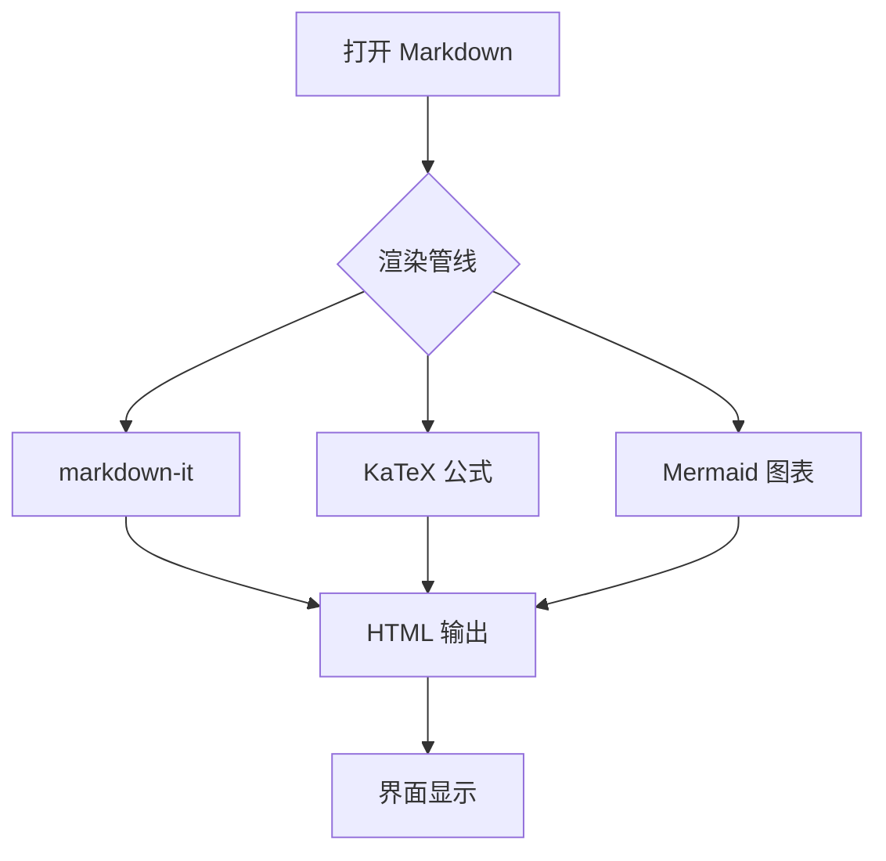

# Markdown 查看器 · 功能演示

这是一个用于验证渲染效果的示例文档，覆盖了软件支持的全部语法。

## 一、文本与列表

**加粗**、*斜体*、~~删除线~~、`行内代码`，以及[外链](https://example.com)和[内部锚点](#三表格)。

- 普通列表项
- 支持任务清单：

- [x] 已完成：渲染管线
- [x] 已完成：图片查重
- [ ] 待完成：导出 PDF

> 引用块：用于摘录重点内容。
> 支持多行。

## 二、标题层级与目录

左侧「大纲」面板会实时列出本文档的所有标题，滚动时自动高亮当前位置。三级及以下的标题会缩进显示，方便长文档快速跳转。

### 2.1 子标题示例

正文段落。脚注功能同样可用[^1]。

[^1]: 这是脚注内容，会显示在文档底部。

## 三、表格

| 项目 | 参数 | 备注 |
| --- | --- | --- |
| 用地面积 | 45,230 ㎡ | 二类居住用地 |
| 容积率 | 2.4 | 上限 |
| 建筑密度 | 22% | — |
| 绿地率 | 35% | 不小于 30% |

表格会自动包裹横向滚动容器，窄窗口下不会撑破排版。

## 四、代码块

```js
// 支持语法高亮、行号统计与一键复制
function analyze(images) {
  const map = new Map()
  for (const img of images) {
    const hash = md5(img.buffer)
    if (map.has(hash)) map.get(hash).push(img)
    else map.set(hash, [img])
  }
  return map
}
```

```python
def probe_size(buf: bytes) -> tuple:
    if buf[:8] == b"\x89PNG\r\n\x1a\n":
        return int.from_bytes(buf[16:20], "big"), int.from_bytes(buf[20:24], "big")
    return 0, 0
```

## 五、Mermaid 图表



## 六、数学公式

行内公式：勾股定理 $a^2 + b^2 = c^2$ 是最基础的几何关系。

块级公式：

$$
\int_{-\infty}^{\infty} e^{-x^2}\,dx = \sqrt{\pi}
$$

## 七、图片

下方图片若存在，会显示实际尺寸与体积；点击任意图片可进入全屏画廊，支持左右键翻页。缺失的图片会被红框标出，并在「图片」面板中列出。


---

## 快捷键

| 操作 | 快捷键 |
| --- | --- |
| 打开文件 | `Ctrl + O` |
| 打开文件夹 | `Ctrl + Shift + O` |
| 编辑模式 | `Ctrl + E` |
| 保存 | `Ctrl + S` |
| 文档内查找 | `Ctrl + F` |
| 文件夹内搜索 | `Ctrl + Shift + F` |
| 侧边栏 | `Ctrl + B` |
| 大纲 | `Ctrl + J` |
| 切换主题 | `Ctrl + D` |
| 专注模式 | `F8` |
